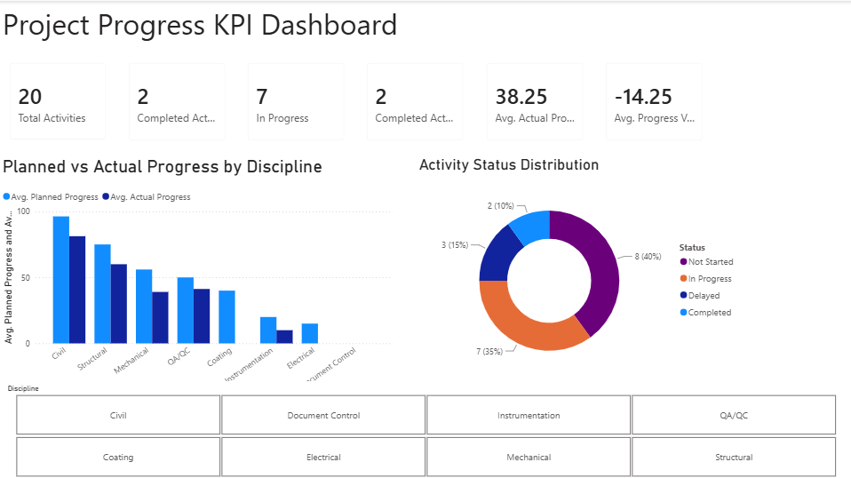

# Project Progress KPI Dashboard

A row-by-row activity tracker is hard to scan when you need planned progress, actual progress, and late work in one view. Discipline gaps stay buried in the sheet.

This sample turns that tracker into an Excel dashboard and a Power BI report. Refresh the workbook and the summary rebuilds from the activity table.

## What you'd get

- [Excel workbook](Project_Progress_KPI_Dashboard.xlsx): the 20-activity table, a Power Query result with delay, variance, and status columns, pivot summaries, charts, a dashboard, and a project summary sheet
- [Power BI report](Project_Progress_KPI_Dashboard_PowerBI.pbix): KPI cards, planned versus actual progress by discipline, an activity status chart, and a discipline slicer
- [Screenshot](powerbi-dashboard.png) of the Power BI report

All data in this repo is synthetic demo/sample data, not client work.

## Business Problem

Project teams need one view of execution against the plan. A row-by-row tracker makes it harder to see which disciplines are behind and which activities need follow-up.

## Solution

Excel Power Query reads the `tbl_ProjectProgress` table in this workbook. It adds delay days, progress variance, a performance status, and a schedule status. Formulas, PivotTables, and PivotCharts feed the `Dashboard` sheet. Power BI shows KPI cards, a planned versus actual column chart, an activity status chart, and a discipline slicer.

## Data

The workbook contains 20 activity records with discipline, responsible team, planned and actual dates, progress percentages, and status. `Raw_Data` holds the source table. `qry_ProjectProgress_Clean` holds the query result, so the inputs and the added columns can be checked.

All data in this repo is synthetic demo/sample data, not client work. The saved figures show the reporting approach on this sample.

## Analysis and Decision Support

| Measure | Saved result |
|---|---:|
| Total activities | 20 |
| Completed / In Progress / Delayed / Not Started | 2 / 7 / 3 / 8 |
| Average planned progress | 52.5% |
| Average actual progress | 38.25% |
| Average progress variance | -14.25 percentage points |

These progress percentages are simple averages of the 20 activities. They are not weighted by effort or cost.

`Pivot_Analysis` shows the same planned and actual averages by discipline. `Pivot_Status` counts activities by status. Those views can support a review of delayed activities and of disciplines behind plan.

## Automated Action

Refreshing the workbook rebuilds the query table, PivotTables, and charts from `tbl_ProjectProgress`. The project covers that reporting view. Alerting and task-list updates are outside this workbook.

## Measured / Demonstrated Outcome

The saved Excel dashboard shows average actual progress of 38.25% against average planned progress of 52.5%, a gap of 14.25 percentage points. That is a snapshot of this sample. It does not measure a later change in delivery.

**Interpretation note:** the Excel `Dashboard` label "Completed Late" is 2. The cell counts rows whose `Schedule_Status` is Delayed. In this saved table, both of those rows have an actual finish one day after the planned finish. One of them is still marked Delayed, with 90% actual progress. Read 2 as that date-based count, not two activities whose status is Completed.

## Tools and Outputs

Excel, Power Query, formulas, PivotTables, PivotCharts, and Power BI Desktop (DAX measures, charts, and a discipline slicer).

The [Excel workbook](Project_Progress_KPI_Dashboard.xlsx) includes `Raw_Data`, `qry_ProjectProgress_Clean`, `Dashboard`, `Pivot_Analysis`, `Pivot_Status`, and `Project_Summary`. The [Power BI file](Project_Progress_KPI_Dashboard_PowerBI.pbix) is the interactive report. The [screenshot](powerbi-dashboard.png) is a preview.

## How to Run

1. Download this repository. Open `Project_Progress_KPI_Dashboard.xlsx` and start with `Dashboard` or `Project_Summary`.
2. The query `qry_ProjectProgress_Clean` reads `tbl_ProjectProgress` on the `Raw_Data` sheet in this same workbook. In Excel, refresh all data so the query, PivotTables, and charts rebuild.
3. Open `Project_Progress_KPI_Dashboard_PowerBI.pbix` in Power BI Desktop. If Desktop asks for the workbook, select `Project_Progress_KPI_Dashboard.xlsx` from this folder, then refresh. Use the discipline slicer to filter the report.

[Portfolio overview](https://github.com/23-06109#selected-projects)

## Work with me

I offer a fixed-price, async Operations Reporting Automation Sprint: you send a messy Excel/CSV tracker, I send back a clean report that rebuilds on refresh, an overdue action list and a short how-to video. No meetings. Message me on LinkedIn: https://www.linkedin.com/in/jimmyjrmanalon/
